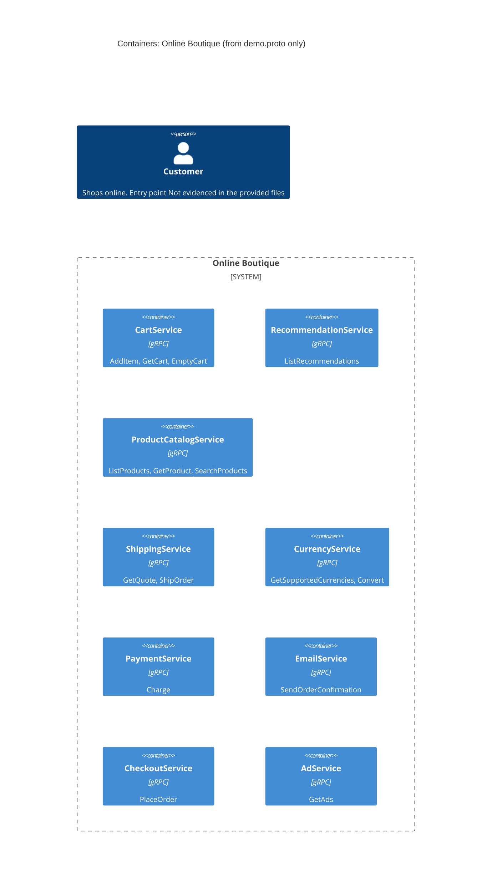

# 1A: Recovered architecture (C4 container level)

## 1. Agent

- Product: Claude Code (Anthropic)
- Model: Claude Opus 5.5 (`claude-opus-5-5`)

## 2. Files read

Evidence:

- `system/online-boutique/protos/demo.proto`

Task instructions (not used as evidence):

- `AGENTS.md`
- `prompts/1-recover-architecture.md`

## 3. Containers table

The evidence is one gRPC interface definition (`syntax = "proto3"`, `package hipstershop`, line 15–17). It declares 9 gRPC services. Each is listed as a container because it exposes its own API. The proto does **not** say how services are deployed, so "one service = one container" is **[Inferred]**.

| # | Container (proto service) | Technology / language | Responsibility (from RPCs) | Evidence |
|---|---|---|---|---|
| 1 | CartService | gRPC (proto3). Language: Not evidenced in the provided files | Add items to a user's cart, get it, empty it (`AddItem`, `GetCart`, `EmptyCart`) | `system/online-boutique/protos/demo.proto` (`service CartService`, l.23–27) |
| 2 | RecommendationService | gRPC (proto3). Language: Not evidenced | Recommend product IDs for a user and a set of products (`ListRecommendations`) | `system/online-boutique/protos/demo.proto` (`service RecommendationService`, l.56–58) |
| 3 | ProductCatalogService | gRPC (proto3). Language: Not evidenced | List, get and search products (`ListProducts`, `GetProduct`, `SearchProducts`) | `system/online-boutique/protos/demo.proto` (`service ProductCatalogService`, l.71–75) |
| 4 | ShippingService | gRPC (proto3). Language: Not evidenced | Quote shipping cost and ship an order, returning a tracking ID (`GetQuote`, `ShipOrder`) | `system/online-boutique/protos/demo.proto` (`service ShippingService`, l.107–110) |
| 5 | CurrencyService | gRPC (proto3). Language: Not evidenced | List supported currencies, convert `Money` between currencies (`GetSupportedCurrencies`, `Convert`) | `system/online-boutique/protos/demo.proto` (`service CurrencyService`, l.140–143) |
| 6 | PaymentService | gRPC (proto3). Language: Not evidenced | Charge a credit card for an amount, returning a transaction ID (`Charge`) | `system/online-boutique/protos/demo.proto` (`service PaymentService`, l.177–179) |
| 7 | EmailService | gRPC (proto3). Language: Not evidenced | Send an order confirmation to an email address (`SendOrderConfirmation`) | `system/online-boutique/protos/demo.proto` (`service EmailService`, l.199–201) |
| 8 | CheckoutService | gRPC (proto3). Language: Not evidenced | Place an order and return an `OrderResult` (`PlaceOrder`) | `system/online-boutique/protos/demo.proto` (`service CheckoutService`, l.224–226) |
| 9 | AdService | gRPC (proto3). Language: Not evidenced | Return ads for a set of context keywords (`GetAds`) | `system/online-boutique/protos/demo.proto` (`service AdService`, l.243–245) |

Notes:

- `option go_package = ".../hipstershop"` (l.19) only names the Go package for generated stubs. It does not show which language any service is written in.
- **Data stores:** none evidenced. No database, cache or message broker appears in the proto.

## 4. Dependencies table

A `.proto` file defines what each service **offers**. It does not say who **calls** whom. So no runtime caller → callee dependency is evidenced.

| Caller → callee | Protocol | Evidence |
|---|---|---|
| *(none evidenced)* | n/a | `system/online-boutique/protos/demo.proto` declares services and messages only; no client addresses, environment variables or call sites |

Dependencies that the message shapes suggest are listed under **Gaps** as **[Inferred]**. They are deliberately left out of this table and the diagram.

## 5. Mermaid diagram

This matches the two tables: 9 containers and no `Rel`, because no dependency is evidenced. There is no `Person` relationship either, since the end user's entry point (e.g. a web frontend) is not in the evidence.

## 6. Gaps

| Gap | What the proto suggests | Extra file that would settle it |
|---|---|---|
| Who calls whom (all runtime dependencies) | **[Inferred]** `CheckoutService` probably calls `CartService`, `ProductCatalogService`, `CurrencyService`, `ShippingService`, `PaymentService` and `EmailService`. `PlaceOrderRequest` (l.228–235) carries `user_id`, `user_currency`, `Address`, `email` and `CreditCardInfo`, which are exactly the inputs of `GetCart`, `Convert`, `GetQuote`/`ShipOrder`, `Charge` and `SendOrderConfirmation`. `OrderResult` (l.208–214) holds a `shipping_tracking_id` and `shipping_cost` like those `ShippingService` returns. | `system/online-boutique/kubernetes-manifests/checkoutservice.yaml` (env vars such as `*_SERVICE_ADDR`) or the checkout service source code |
| User-facing entry point (web frontend) and how the user reaches the system | Not evidenced. No frontend or HTTP API is defined in the proto. **[Inferred]** Some client calls `CartService`, `ProductCatalogService`, `RecommendationService`, `AdService`, `CurrencyService` and `CheckoutService`, because their requests take `user_id`, page `context_keys` or display data. | `system/online-boutique/kubernetes-manifests/frontend.yaml` and the frontend source code |
| Implementation language of each service | Not evidenced (`go_package`, l.19, only covers generated stubs) | Each service's source folder under `system/online-boutique/src/` (or its Dockerfile) |
| Where cart data is stored (database/cache) | Not evidenced. **[Inferred]** `CartService` keeps per-user state (`GetCart` by `user_id`), so it may need a data store. | `system/online-boutique/kubernetes-manifests/cartservice.yaml` (e.g. a cache address env var) and any data-store manifests |
| Source of product data | Not evidenced (no storage shown for `ProductCatalogService`) | Product catalog service source code |
| External systems (real payment gateway, email provider, currency rates source) | Not evidenced. `PaymentService.Charge` and `EmailService.SendOrderConfirmation` may or may not call external providers. | Payment, email and currency service source code |
| Deployment unit (one container per service?) and ports | Not evidenced | `system/online-boutique/kubernetes-manifests/*.yaml` |
| Does `RecommendationService` call `ProductCatalogService`? | **[Inferred]** Possibly, since it returns `product_ids` it needs to choose from. Not proven. | Recommendation service source code or its Kubernetes manifest |
