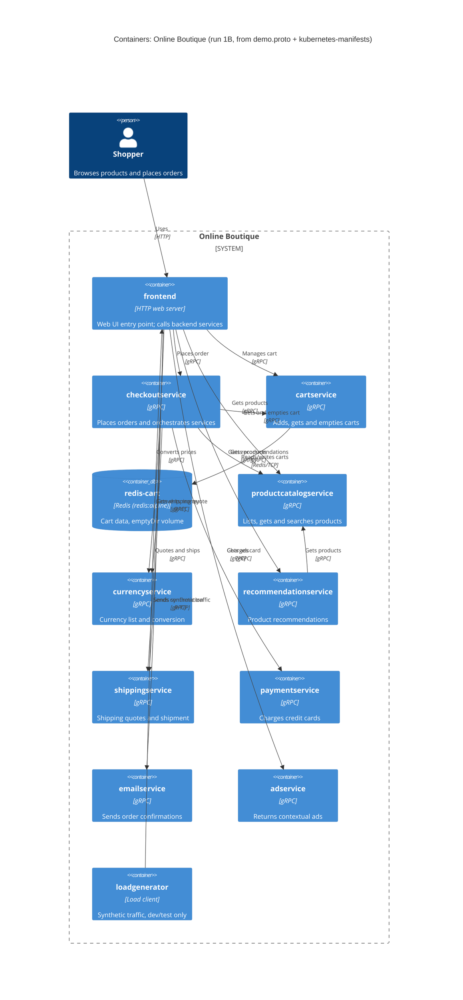

# 1B: Recovered C4 container architecture (Online Boutique)

## 1. Agent

- Product: Claude Code (Anthropic)
- Model: Claude Opus 5.5 (`claude-opus-5-5`)
- Run: `B`
- Evidence allowed: `system/online-boutique/protos/demo.proto`, `system/online-boutique/kubernetes-manifests/`

## 2. Files read

Task files:
- `AGENTS.md`
- `prompts/1-recover-architecture.md`

Evidence:
- `system/online-boutique/protos/demo.proto`
- `system/online-boutique/kubernetes-manifests/kustomization.yaml`
- `system/online-boutique/kubernetes-manifests/README.md`
- `system/online-boutique/kubernetes-manifests/frontend.yaml`
- `system/online-boutique/kubernetes-manifests/adservice.yaml`
- `system/online-boutique/kubernetes-manifests/cartservice.yaml`
- `system/online-boutique/kubernetes-manifests/checkoutservice.yaml`
- `system/online-boutique/kubernetes-manifests/currencyservice.yaml`
- `system/online-boutique/kubernetes-manifests/emailservice.yaml`
- `system/online-boutique/kubernetes-manifests/paymentservice.yaml`
- `system/online-boutique/kubernetes-manifests/productcatalogservice.yaml`
- `system/online-boutique/kubernetes-manifests/recommendationservice.yaml`
- `system/online-boutique/kubernetes-manifests/shippingservice.yaml`
- `system/online-boutique/kubernetes-manifests/loadgenerator.yaml`

Attempted but not present: `system/online-boutique/kubernetes-manifests/redis.yaml` (file does not exist; Redis is defined inside `cartservice.yaml`).

Note: no folder-listing tool was available in this session, so the manifest files were enumerated from the `resources:` list in `kustomization.yaml` (plus `loadgenerator.yaml`, commented out there, and `README.md`). Any other file in the folder that is not referenced there was not seen.

## 3. Containers table

Implementation language of the services is **Not evidenced in the provided files**: the manifests only give unqualified image names (e.g. `image: frontend`), and `README.md` says the real tags are injected by `skaffold`. "gRPC" below is the interface technology, evidenced by the proto `service` definitions, the Kubernetes Service port name `grpc`, and the `grpc:` readiness/liveness probes.

| Container | Technology | Responsibility | Evidence |
|---|---|---|---|
| `frontend` | HTTP web server, port 8080 (language not evidenced) | Web UI entry point for shoppers; exposed externally on port 80; calls the backend services | `kubernetes-manifests/frontend.yaml` (Deployment `frontend`, `httpGet` probes on `/_healthz`, Service `frontend-external` `type: LoadBalancer`, port name `http`) |
| `adservice` | gRPC service, port 9555 | Returns ads for page context keys (`GetAds`) | `protos/demo.proto` (`service AdService`); `kubernetes-manifests/adservice.yaml` (Service port `grpc` 9555) |
| `cartservice` | gRPC service, port 7070 | Adds items to, gets and empties a user's cart (`AddItem`, `GetCart`, `EmptyCart`) | `protos/demo.proto` (`service CartService`); `kubernetes-manifests/cartservice.yaml` (Deployment `cartservice`, Service port `grpc` 7070) |
| `redis-cart` | Redis (`redis:alpine`), port 6379 | Cart data store for `cartservice`; data in an `emptyDir` volume (lost when the pod is removed) | `kubernetes-manifests/cartservice.yaml` (Deployment `redis-cart`, `image: redis:alpine`, volume `redis-data: emptyDir`, Service port `tcp-redis` 6379) |
| `checkoutservice` | gRPC service, port 5050 | Places an order (`PlaceOrder`) and orchestrates the other services | `protos/demo.proto` (`service CheckoutService`); `kubernetes-manifests/checkoutservice.yaml` (Service port `grpc` 5050) |
| `currencyservice` | gRPC service, port 7000 | Lists supported currencies and converts money (`GetSupportedCurrencies`, `Convert`) | `protos/demo.proto` (`service CurrencyService`); `kubernetes-manifests/currencyservice.yaml` (Service port `grpc` 7000) |
| `emailservice` | gRPC service, Service port 5000 → container port 8080 | Sends order confirmation (`SendOrderConfirmation`) | `protos/demo.proto` (`service EmailService`); `kubernetes-manifests/emailservice.yaml` (Service port `grpc` 5000, `targetPort: 8080`) |
| `paymentservice` | gRPC service, port 50051 | Charges a credit card (`Charge`) | `protos/demo.proto` (`service PaymentService`); `kubernetes-manifests/paymentservice.yaml` (Service port `grpc` 50051) |
| `productcatalogservice` | gRPC service, port 3550 | Lists, gets and searches products (`ListProducts`, `GetProduct`, `SearchProducts`) | `protos/demo.proto` (`service ProductCatalogService`); `kubernetes-manifests/productcatalogservice.yaml` (Service port `grpc` 3550) |
| `recommendationservice` | gRPC service, port 8080 | Recommends product IDs (`ListRecommendations`) | `protos/demo.proto` (`service RecommendationService`); `kubernetes-manifests/recommendationservice.yaml` (Service port `grpc` 8080) |
| `shippingservice` | gRPC service, port 50051 | Quotes shipping cost and ships orders (`GetQuote`, `ShipOrder`) | `protos/demo.proto` (`service ShippingService`); `kubernetes-manifests/shippingservice.yaml` (Service port `grpc` 50051) |
| `loadgenerator` | Load-generating client (language not evidenced) | Sends synthetic traffic to the frontend (`USERS=10`, `RATE=1`); dev/test only, commented out of `kustomization.yaml` | `kubernetes-manifests/loadgenerator.yaml` (Deployment `loadgenerator`); `kubernetes-manifests/kustomization.yaml` (`# - loadgenerator.yaml`) |

All paths above are relative to `system/online-boutique/`.

## 4. Dependencies table

| Caller → callee | Protocol | Evidence |
|---|---|---|
| Shopper → `frontend` | HTTP | `kubernetes-manifests/frontend.yaml` (Service `frontend-external`, `type: LoadBalancer`, port name `http`, 80 → 8080) |
| `loadgenerator` → `frontend` | HTTP | `kubernetes-manifests/loadgenerator.yaml` (`FRONTEND_ADDR=frontend:80`; init container `wget http://${FRONTEND_ADDR}`) |
| `frontend` → `productcatalogservice` | gRPC | `kubernetes-manifests/frontend.yaml` (`PRODUCT_CATALOG_SERVICE_ADDR=productcatalogservice:3550`) |
| `frontend` → `currencyservice` | gRPC | `kubernetes-manifests/frontend.yaml` (`CURRENCY_SERVICE_ADDR=currencyservice:7000`) |
| `frontend` → `cartservice` | gRPC | `kubernetes-manifests/frontend.yaml` (`CART_SERVICE_ADDR=cartservice:7070`) |
| `frontend` → `recommendationservice` | gRPC | `kubernetes-manifests/frontend.yaml` (`RECOMMENDATION_SERVICE_ADDR=recommendationservice:8080`) |
| `frontend` → `shippingservice` | gRPC | `kubernetes-manifests/frontend.yaml` (`SHIPPING_SERVICE_ADDR=shippingservice:50051`) |
| `frontend` → `checkoutservice` | gRPC | `kubernetes-manifests/frontend.yaml` (`CHECKOUT_SERVICE_ADDR=checkoutservice:5050`) |
| `frontend` → `adservice` | gRPC | `kubernetes-manifests/frontend.yaml` (`AD_SERVICE_ADDR=adservice:9555`) |
| `checkoutservice` → `productcatalogservice` | gRPC | `kubernetes-manifests/checkoutservice.yaml` (`PRODUCT_CATALOG_SERVICE_ADDR=productcatalogservice:3550`) |
| `checkoutservice` → `shippingservice` | gRPC | `kubernetes-manifests/checkoutservice.yaml` (`SHIPPING_SERVICE_ADDR=shippingservice:50051`) |
| `checkoutservice` → `paymentservice` | gRPC | `kubernetes-manifests/checkoutservice.yaml` (`PAYMENT_SERVICE_ADDR=paymentservice:50051`) |
| `checkoutservice` → `emailservice` | gRPC | `kubernetes-manifests/checkoutservice.yaml` (`EMAIL_SERVICE_ADDR=emailservice:5000`) |
| `checkoutservice` → `currencyservice` | gRPC | `kubernetes-manifests/checkoutservice.yaml` (`CURRENCY_SERVICE_ADDR=currencyservice:7000`) |
| `checkoutservice` → `cartservice` | gRPC | `kubernetes-manifests/checkoutservice.yaml` (`CART_SERVICE_ADDR=cartservice:7070`) |
| `recommendationservice` → `productcatalogservice` | gRPC | `kubernetes-manifests/recommendationservice.yaml` (`PRODUCT_CATALOG_SERVICE_ADDR=productcatalogservice:3550`) |
| `cartservice` → `redis-cart` | Redis protocol over TCP | `kubernetes-manifests/cartservice.yaml` (`REDIS_ADDR=redis-cart:6379`; Service `redis-cart` port name `tcp-redis`) |

How "gRPC" is evidenced: the caller's `*_ADDR` variable gives only host:port; the protocol comes from the callee's Service port being named `grpc` and probed with `grpc:` probes in its manifest, and from the matching `service …` block in `protos/demo.proto`. Which specific RPCs each caller invokes is **Not evidenced in the provided files**.

## 5. Mermaid diagram

Rel labels describe the callee's purpose from its proto service; the exact RPCs used per edge are not evidenced (see Gaps).

## 6. Gaps

| Gap | Why it is open | File that would settle it |
|---|---|---|
| `shoppingassistantservice` | `frontend.yaml` sets `SHOPPING_ASSISTANT_SERVICE_ADDR=shoppingassistantservice:80`, but no manifest for it is in the evidence and `kustomization.yaml` only lists `../kustomize/components/shopping-assistant` as a commented-out component. Existence, protocol and responsibility not evidenced, so it is **not** in the diagram. | `system/online-boutique/kustomize/components/shopping-assistant/` and the frontend source that uses this variable (e.g. `system/online-boutique/src/frontend/main.go`) |
| Implementation language of each service | Manifests give only bare image names (`image: cartservice`, …). | Each service's `Dockerfile` / source under `system/online-boutique/src/<service>/` |
| Which RPCs each caller actually invokes | Proto defines services, not callers; env vars show only addresses. | Client code, e.g. `system/online-boutique/src/frontend/rpc.go`, `system/online-boutique/src/checkoutservice/main.go` |
| Whether `frontend` → `shippingservice` and `frontend` → `checkoutservice` are used on every request or only on cart/checkout pages | Not evidenced. | `system/online-boutique/src/frontend/handlers.go` |
| External systems (real payment processor, SMTP/email provider) | `paymentservice` and `emailservice` have no outbound address variables; whether they call anything external (or are mocks) is not evidenced. No `System_Ext` is drawn. | `system/online-boutique/src/paymentservice/`, `system/online-boutique/src/emailservice/` |
| Data stores of `productcatalogservice`, `adservice`, `currencyservice` | No DB address variables or volumes in their manifests; where product/ad/rate data comes from is not evidenced. | `system/online-boutique/src/productcatalogservice/` (and the others' source) |
| Alternative cart stores (Memorystore, AlloyDB, Spanner) | Only commented-out components in `kustomization.yaml`; the default is `redis-cart`. | `system/online-boutique/kustomize/components/{memorystore,alloydb,spanner}/` |
| Inter-service security (mTLS, NetworkPolicies) and observability | `network-policies` and `google-cloud-operations` are commented-out components; `sidecar.istio.io/rewriteAppHTTPProbers` annotation hints at optional Istio, but no mesh config is in evidence. | `system/online-boutique/kustomize/components/network-policies/`, `system/online-boutique/istio-manifests/` |
| Synchronous vs asynchronous messaging | No message broker appears in the evidence; all edges are request/response gRPC or Redis. Whether any async path exists elsewhere is not evidenced. | Service source under `system/online-boutique/src/` |
| Other files in `kubernetes-manifests/` | Folder could not be listed in this session; files were taken from `kustomization.yaml`. | A directory listing of `system/online-boutique/kubernetes-manifests/` |
| `PACKAGING_SERVICE_URL` (optional "packaging service") | Only a commented-out env var in `frontend.yaml`; not deployed by default. | Frontend source and the optional Google Cloud demo docs |
